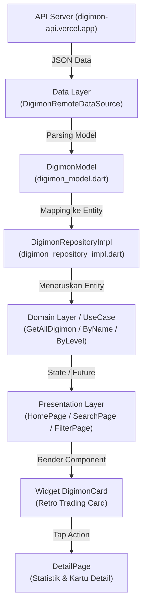

# 🎴 Digimon Card Collection App

Aplikasi katalog kartu koleksi Digimon berbasis **Flutter** dengan tampilan retro **Digimon Carddass / Digi-Battle (1999 Trading Card Series)** bergaya album binder kartu saku 3x3.

---

## 📋 Daftar Isi

1. [Bahasa & Teknologi yang Digunakan](#1-bahasa--teknologi-yang-digunakan)
2. [Alur Program & Arsitektur](#2-alur-program--arsitektur)
3. [Fitur-Fitur Aplikasi](#3-fitur-fitur-aplikasi)
4. [Sumber API & Data Endpoint](#4-sumber-api--data-endpoint)
5. [Cara Menjalankan Aplikasi](#5-cara-menjalankan-aplikasi)
6. [Panduan Maintenance & Modifikasi Kode](#6-panduan-maintenance--modifikasi-kode)

---

## 1. Bahasa & Teknologi yang Digunakan

| Komponen               | Teknologi                               | Deskripsi                                                        |
| :--------------------- | :-------------------------------------- | :--------------------------------------------------------------- |
| **Bahasa Pemrograman** | **Dart** (v3.5.1+)                      | Bahasa utama untuk pengembangan aplikasi Flutter                 |
| **Framework**          | **Flutter** (Channel Stable)            | Framework UI multiplatform (Android, Web, Desktop)               |
| **Target OS Demo**     | **Android** (API 21 - 36+)              | Dijalankan langsung pada perangkat fisik melalui USB Debugging   |
| **HTTP Client**        | `dio: ^5.0.0`                           | Pengambilan data dari Digimon Public REST API                    |
| **Image Caching**      | `cached_network_image: ^3.2.3`          | Memuat gambar secara cepat dan menyimpan cache di memori/storage |
| **Loading Effect**     | `shimmer: ^2.0.0`                       | Animasi shimmer skeleton loading pada grid kartu                 |
| **Offline Storage**    | `hive: ^2.2.3` & `hive_flutter: ^1.1.0` | Penyimpanan lokal / basis data NoSQL ringan                      |
| **Pola Arsitektur**    | **Clean Architecture**                  | Pemisahan berlapis (_Data_, _Domain_, dan _Presentation_)        |

---

## 2. Alur Program & Arsitektur

Aplikasi ini dibangun menggunakan prinsip **Clean Architecture** yang terbagi menjadi 3 layer utama:



### Penjelasan Setiap Layer:

1. **Core Layer (`lib/core/`)**:
   - `network/api_client.dart`: Konfigurasi dasar client HTTP (`Dio`).
   - `utils/constants.dart`: Nilai konstanta global aplikasi.
2. **Data Layer (`lib/data/`)**:
   - `datasources/digimon_remote_datasource.dart`: Menghubungi REST API melalui internet.
   - `models/digimon_model.dart`: Memetakan format JSON mentah menjadi objek Dart.
   - `repositories/digimon_repository_impl.dart`: Mengimplementasikan kontrak repositori dari domain layer.
3. **Domain Layer (`lib/domain/`)**:
   - `entities/digimon_entity.dart`: Objek bisnis inti (_Name_, _Img_, _Level_).
   - `repositories/digimon_repository.dart`: Kontrak/interface abstraksi data.
   - `usecases/`: Logika bisnis per aksi (`GetAllDigimon`, `GetDigimonByName`, `GetDigimonByLevel`).
4. **Presentation Layer (`lib/presentation/`)**:
   - `pages/`: Halaman UI (`home_page.dart`, `search_page.dart`, `filter_page.dart`, `detail_page.dart`).
   - `widgets/`: Komponen UI kustom (`digimon_card.dart` untuk kartu retro, `digimon_shimmer.dart` untuk loading).

---

## 3. Fitur-Fitur Aplikasi

1. **Album Kartu Retro (Carddass 1999 Style)**:
   - Tampilan grid bergaya **lembaran album binder kartu saku 3x3** (seperti koleksi kartu fisik).
   - Dilengkapi **Outer Border** tembaga/emas/slate yang bervariasi per kartu.
   - **Silver Prism Badge**: Stempel prisma logam perak di pojok kiri atas.
   - **Logo DIGIMON Kuning**: Lencana oval retro khas Digimon di pojok kanan atas.
   - **Latar Digital Matrix & Watermark Crest**: Pola kisi-kisi siber dan simbol crest di belakang karakter.
   - **Dual-tone Nameplate**: Bar nama biru gelap + kotak putih nilai **DP (Digimon Power)**, serta nomor seri kartu dan level.
2. **Toggle Mode Tampilan Grid (3 Kolom & 2 Kolom)**:
   - Tombol pada AppBar atas untuk beralih instan antara:
     - **3 Kolom**: Tampilan binder saku (mirip foto album koleksi).
     - **2 Kolom**: Tampilan kartu lebih besar dan detail.
3. **Pencarian Kartu Real-Time (Search)**:
   - Memfilter kartu seketika saat pengguna mengetikkan nama Digimon (misal: _Agumon_, _Patamon_).
4. **Filter Berdasarkan Level**:
   - Menyaring kartu Digimon berdasarkan tingkat evolusi:
     - `Fresh`, `In Training`, `Rookie`, `Champion`, `Ultimate`, `Mega`, `Armor`.
5. **Halaman Detail Kartu Resolusi Tinggi**:
   - Kartu ditampilkan dalam skala besar dengan animasi transisi `Hero`.
   - Menampilkan ringkasan statistik kolektor: Nomor Kartu (`#001`), Nama, Tahap Level, Poin DP, dan Seri.
6. **Animasi Skeleton Shimmer**:
   - Efek placeholder loading grid kartu yang halus saat data sedang dimuat dari server.

---

## 4. Sumber API & Data Endpoint

Data Digimon diambil secara publik melalui REST API:

- **Base URL**: `https://digimon-api.vercel.app/api/digimon`

### Daftar Endpoint:

| Kebutuhan                    | Method | Endpoint URL                                              | Keterangan                                        |
| :--------------------------- | :----: | :-------------------------------------------------------- | :------------------------------------------------ |
| **Semua Digimon**            | `GET`  | `https://digimon-api.vercel.app/api/digimon`              | Mengambil seluruh katalog Digimon (~209 karakter) |
| **Cari Berdasarkan Nama**    | `GET`  | `https://digimon-api.vercel.app/api/digimon/name/:name`   | Mengambil detail spesifik satu nama Digimon       |
| **Filter Berdasarkan Level** | `GET`  | `https://digimon-api.vercel.app/api/digimon/level/:level` | Mengambil semua Digimon pada level tertentu       |

### Struktur Format Data (JSON):

```json
[
  {
    "name": "Agumon",
    "img": "https://digimon.shadowsmith.com/img/agumon.jpg",
    "level": "Rookie"
  }
]
```

---

## 5. Cara Menjalankan Aplikasi

> [!IMPORTANT]
> Pastikan Anda berada di subfolder `digimon_app` (folder yang memuat file `pubspec.yaml`), bukan di folder induk terluar.

### 1. Masuk ke Direktori Proyek

```powershell
cd D:\PROJECT\digimon_app\digimon_app
```

### 2. Pastikan HP Terhubung & Terdeteksi

Periksa apakah HP sudah terdeteksi di USB Debugging:

```powershell
flutter devices
```

### 3. Jalankan Aplikasi ke HP

```powershell
flutter run -d 2412DPC0AG
```

_(Ganti `2412DPC0AG` dengan nama/ID perangkat Anda jika menggunakan perangkat lain)._

- Tekan huruf **`r`** di terminal untuk melakukan **Hot Reload** (memperbarui perubahan kode secara langsung tanpa mematikan aplikasi).
- Tekan huruf **`R`** untuk **Hot Restart**.
- Tekan huruf **`q`** untuk keluar.

---

## 6. Panduan Maintenance & Modifikasi Kode

Gunakan daftar di bawah ini sebagai panduan cepat saat Anda ingin mengubah tampilan atau fungsionalitas aplikasi:

### A. Mengubah Desain & Tampilan Kartu

📁 **File:** `lib/presentation/widgets/digimon_card.dart`

- **Ubah Warna Frame/Border Kartu:** Modifikasi method `_CardTheme get _theme` (baris ~36). Anda dapat mengubah kode hex warna seperti `borderColor`, `bgTop`, `bgBottom`.
- **Ubah Rasio/Ukuran Kartu:** Cari `aspectRatio: 0.68` di widget `AspectRatio`. Nilai `0.68` adalah standar proporsi kartu trading (2.5 : 3.5).
- **Ubah Nilai DP (Digimon Power):** Cari method `int get _dpValue` (baris ~20) untuk menyesuaikan rumus pembagian poin DP tiap level.
- **Ubah Pola Garis Grid / Watermark:** Modifikasi class `_CardBackgroundPainter` (baris ~340) yang menggambar garis kisi-kisi dan simbol crest.
- **Ubah Teks Logo Atas ("DIGIMON"):** Modifikasi method `_buildDigimonLogo()`.
- **Ubah Stempel Perak (Kiri Atas):** Modifikasi method `_buildSilverPrismBadge()`.

### B. Mengubah Tata Letak Halaman Utama (Home Page)

📁 **File:** `lib/presentation/pages/home_page.dart`

- **Ubah Jumlah Kolom Default:** Ubah variabel `int _crossAxisCount = 3;` (baris ~18) menjadi `2` jika ingin tampilan 2 kolom secara default.
- **Ubah Jarak Antar Kartu:** Atur nilai `crossAxisSpacing` dan `mainAxisSpacing` pada `SliverGridDelegateWithFixedCrossAxisCount`.
- **Ubah Judul / Menu Drawer:** Ubah teks dan ikon pada `AppBar` atau `DrawerHeader`.

### C. Mengubah Halaman Pencarian

📁 **File:** `lib/presentation/pages/search_page.dart`

- **Ubah Logika Filter:** Cari method `_filterDigimons(String query)`.
- **Ubah Tampilan Kolom Hasil Cari:** Cari widget `GridView.builder` di bagian bawah.

### D. Mengubah Pilihan Filter Level

📁 **File:** `lib/presentation/pages/filter_page.dart`

- **Menambah/Mengurangi Pilihan Level:** Ubah daftar list `levels` (baris ~21):
  ```dart
  final List<String> levels = ['Fresh', 'In Training', 'Rookie', 'Champion', 'Ultimate', 'Mega', 'Armor'];
  ```

### E. Mengubah Halaman Detail

📁 **File:** `lib/presentation/pages/detail_page.dart`

- **Ubah Ukuran Kartu Pratinjau:** Sesuaikan `SizedBox(width: 250, ...)` di dalam body.
- **Menambah Baris Statistik Baru:** Panggil widget pembantu `_buildStatRow(...)` dengan label, value, dan ikon yang diinginkan.

### F. Mengubah Sumber / Endpoint API

📁 **File:** `lib/data/datasources/digimon_remote_datasource.dart`

- Ubah URL string di method `fetchAllDigimon()`, `fetchDigimonByName()`, atau `fetchDigimonByLevel()`.

### G. Menambah Field Data Baru (Misal: Atribut / Tipe Digimon)

Jika Anda mengganti API dengan data yang memiliki field tambahan:

1. Tambah field di entity: `lib/domain/entities/digimon_entity.dart`
2. Tambah parsing JSON di model: `lib/data/models/digimon_model.dart`
3. Perbarui widget kartu: `lib/presentation/widgets/digimon_card.dart`

### H. Menambah Package / Dependensi Baru

📁 **File:** `pubspec.yaml`

- Tambahkan package di bawah blok `dependencies:`.
- Jalankan perintah: `flutter pub get`.

### I. Mengubah Nama Aplikasi & Ikon di Layar HP

- **Nama Aplikasi (Android):** `android/app/src/main/AndroidManifest.xml` pada tag `android:label="digimon_card"`.
- **Ikon Aplikasi:** Simpan gambar ikon di dalam folder `android/app/src/main/res/mipmap-*/`.
